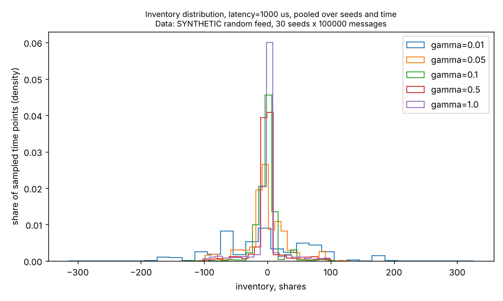
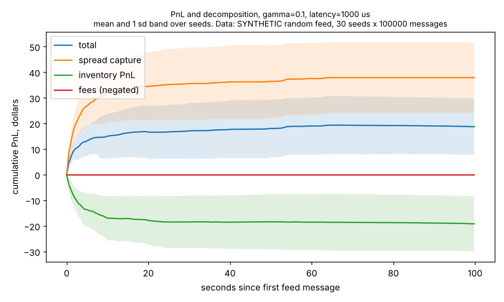
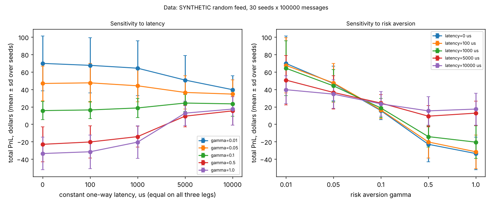
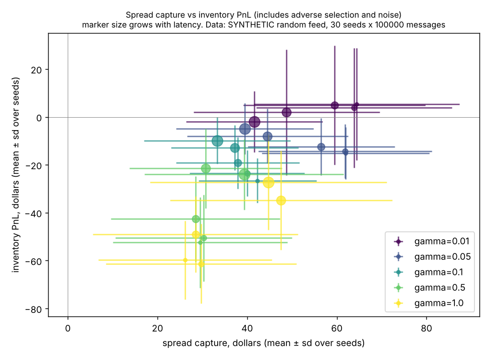

# Phase 6 sweep report (SYNTHETIC data)

Data source: SYNTHETIC. Seeded random order flow (lobkit.synthetic_feed), seeds 1 to 30, 100000 messages per seed.

Each cell is mean ± sample standard deviation over seeds, with [min, max] over seeds. Latency is the same constant one-way value on the submit, acknowledgement and market data legs. Fees are zero. Dollar figures are for the whole synthetic session.

Inventory PnL is the mark to mid component. It contains adverse selection but also plain price noise, so it is only a proxy for adverse selection.

## Fill-model artifact rate

Share of feed messages that were anomalies (queue order anomalies, feed adds that crossed a resting order, feed executes larger than the order) or rejected feed operations. These are the places where the replayed book and the fill model disagreed with the feed. A cell with a high rate says more about the fill model than about the strategy.

fill-model artifact rate over all 750 runs: anomalies 0.082% of feed messages on average (max 0.405%), rejected feed operations 0.113% (max 0.513%)

| gamma | latency (us) | anomaly rate (mean, max over seeds) | rejected-feed rate (mean, max) |
|---|---|---|---|
| 0.01 | 0 | 0.004%, 0.012% | 0.005%, 0.013% |
| 0.01 | 100 | 0.004%, 0.012% | 0.005%, 0.013% |
| 0.01 | 1000 | 0.003%, 0.010% | 0.006%, 0.014% |
| 0.01 | 5000 | 0.003%, 0.009% | 0.009%, 0.024% |
| 0.01 | 10000 | 0.003%, 0.010% | 0.011%, 0.021% |
| 0.05 | 0 | 0.033%, 0.077% | 0.041%, 0.099% |
| 0.05 | 100 | 0.032%, 0.074% | 0.039%, 0.090% |
| 0.05 | 1000 | 0.025%, 0.063% | 0.034%, 0.082% |
| 0.05 | 5000 | 0.020%, 0.045% | 0.033%, 0.074% |
| 0.05 | 10000 | 0.018%, 0.074% | 0.033%, 0.109% |
| 0.1 | 0 | 0.070%, 0.131% | 0.088%, 0.163% |
| 0.1 | 100 | 0.066%, 0.104% | 0.084%, 0.139% |
| 0.1 | 1000 | 0.055%, 0.144% | 0.077%, 0.203% |
| 0.1 | 5000 | 0.056%, 0.140% | 0.085%, 0.229% |
| 0.1 | 10000 | 0.051%, 0.127% | 0.084%, 0.222% |
| 0.5 | 0 | 0.169%, 0.278% | 0.216%, 0.352% |
| 0.5 | 100 | 0.167%, 0.244% | 0.212%, 0.344% |
| 0.5 | 1000 | 0.154%, 0.323% | 0.206%, 0.413% |
| 0.5 | 5000 | 0.092%, 0.234% | 0.137%, 0.339% |
| 0.5 | 10000 | 0.124%, 0.312% | 0.189%, 0.468% |
| 1.0 | 0 | 0.203%, 0.313% | 0.256%, 0.435% |
| 1.0 | 100 | 0.219%, 0.405% | 0.277%, 0.513% |
| 1.0 | 1000 | 0.176%, 0.335% | 0.232%, 0.446% |
| 1.0 | 5000 | 0.168%, 0.350% | 0.243%, 0.501% |
| 1.0 | 10000 | 0.145%, 0.320% | 0.220%, 0.486% |

## Total PnL, dollars

Data: SYNTHETIC. Seeded random order flow (lobkit.synthetic_feed), seeds 1 to 30, 100000 messages per seed.

| gamma \ latency (us) | 0 | 100 | 1000 | 5000 | 10000 |
|---|---|---|---|---|---|
| 0.01 | 69.82 ± 31.52 [26.05, 145.08] | 67.58 ± 31.76 [26.05, 148.92] | 64.32 ± 31.44 [-0.75, 125.73] | 50.69 ± 28.32 [-37.31, 118.46] | 39.66 ± 16.05 [-4.87, 92.13] |
| 0.05 | 46.80 ± 19.87 [21.20, 111.69] | 47.51 ± 22.34 [5.78, 111.69] | 44.13 ± 18.42 [15.68, 96.50] | 36.51 ± 19.00 [-4.66, 84.95] | 34.60 ± 16.19 [6.72, 74.75] |
| 0.1 | 15.68 ± 10.52 [-2.43, 42.25] | 16.42 ± 9.88 [-0.92, 35.33] | 18.71 ± 10.99 [-3.20, 54.94] | 24.32 ± 9.62 [5.96, 49.63] | 23.41 ± 14.17 [0.00, 54.03] |
| 0.5 | -22.99 ± 20.19 [-60.76, 12.44] | -20.33 ± 18.51 [-73.64, 17.10] | -14.18 ± 11.99 [-38.07, 15.65] | 9.29 ± 12.31 [-16.39, 41.00] | 15.35 ± 16.27 [-19.54, 58.21] |
| 1.0 | -33.57 ± 18.71 [-69.84, -1.81] | -31.55 ± 19.22 [-80.12, 6.88] | -20.50 ± 18.66 [-57.46, 18.98] | 12.76 ± 13.96 [-21.04, 41.85] | 17.42 ± 18.35 [-23.31, 59.71] |

Fill-model artifact rate for this table: anomalies 0.082% of feed messages on average (max 0.405%), rejected feed operations 0.113% (max 0.513%)

## Spread capture, dollars

Data: SYNTHETIC. Seeded random order flow (lobkit.synthetic_feed), seeds 1 to 30, 100000 messages per seed.

| gamma \ latency (us) | 0 | 100 | 1000 | 5000 | 10000 |
|---|---|---|---|---|---|
| 0.01 | 64.46 ± 22.93 [18.56, 120.75] | 63.81 ± 21.82 [18.56, 120.61] | 59.45 ± 20.29 [19.55, 108.63] | 48.77 ± 20.75 [19.33, 107.73] | 41.57 ± 15.24 [14.31, 77.59] |
| 0.05 | 61.95 ± 18.66 [30.96, 118.40] | 61.86 ± 19.37 [30.96, 118.40] | 56.48 ± 16.39 [23.88, 106.59] | 44.54 ± 17.91 [11.57, 93.02] | 39.46 ± 15.33 [12.58, 81.06] |
| 0.1 | 42.27 ± 13.14 [20.13, 73.51] | 39.97 ± 12.76 [20.90, 70.64] | 37.90 ± 13.80 [19.34, 78.40] | 37.25 ± 14.19 [14.55, 76.15] | 33.27 ± 16.34 [3.62, 61.77] |
| 0.5 | 29.48 ± 19.45 [-7.93, 77.92] | 30.26 ± 19.67 [-10.94, 77.42] | 28.46 ± 18.87 [-6.72, 61.04] | 30.74 ± 16.97 [5.25, 63.40] | 39.32 ± 22.21 [3.62, 85.02] |
| 1.0 | 26.20 ± 19.35 [-20.27, 53.77] | 29.73 ± 21.22 [-10.68, 65.14] | 28.45 ± 22.83 [-18.53, 84.52] | 47.56 ± 24.74 [10.32, 96.08] | 44.73 ± 26.40 [3.62, 83.90] |

Fill-model artifact rate for this table: anomalies 0.082% of feed messages on average (max 0.405%), rejected feed operations 0.113% (max 0.513%)

## Inventory PnL, dollars

Data: SYNTHETIC. Seeded random order flow (lobkit.synthetic_feed), seeds 1 to 30, 100000 messages per seed.

| gamma \ latency (us) | 0 | 100 | 1000 | 5000 | 10000 |
|---|---|---|---|---|---|
| 0.01 | 5.36 ± 23.45 [-38.77, 63.76] | 3.77 ± 25.08 [-47.12, 63.76] | 4.86 ± 24.83 [-37.39, 78.80] | 1.91 ± 26.22 [-56.64, 69.73] | -1.91 ± 12.77 [-24.71, 27.42] |
| 0.05 | -15.16 ± 10.85 [-42.38, 3.58] | -14.36 ± 11.29 [-42.38, 4.58] | -12.35 ± 11.92 [-44.35, 18.03] | -8.04 ± 11.40 [-36.23, 22.61] | -4.86 ± 10.62 [-26.36, 20.05] |
| 0.1 | -26.59 ± 9.37 [-47.18, -11.40] | -23.55 ± 9.65 [-45.34, -11.18] | -19.20 ± 10.76 [-52.14, -2.82] | -12.92 ± 9.41 [-35.11, -2.34] | -9.86 ± 9.76 [-31.44, 11.12] |
| 0.5 | -52.47 ± 18.89 [-91.87, -16.62] | -50.59 ± 18.08 [-75.25, -8.72] | -42.65 ± 17.94 [-79.22, -18.35] | -21.45 ± 16.64 [-56.23, 3.00] | -23.97 ± 14.74 [-49.88, 2.50] |
| 1.0 | -59.76 ± 16.45 [-97.17, -28.60] | -61.28 ± 16.66 [-99.20, -33.67] | -48.95 ± 15.87 [-91.31, -15.12] | -34.81 ± 20.67 [-71.42, 3.00] | -27.31 ± 19.92 [-67.01, 4.00] |

Fill-model artifact rate for this table: anomalies 0.082% of feed messages on average (max 0.405%), rejected feed operations 0.113% (max 0.513%)

## Fills

Data: SYNTHETIC. Seeded random order flow (lobkit.synthetic_feed), seeds 1 to 30, 100000 messages per seed.

| gamma \ latency (us) | 0 | 100 | 1000 | 5000 | 10000 |
|---|---|---|---|---|---|
| 0.01 | 42.6 ± 13.5 [15.0, 85.0] | 42.1 ± 13.0 [15.0, 84.0] | 40.8 ± 13.5 [17.0, 85.0] | 35.4 ± 13.0 [17.0, 66.0] | 32.5 ± 11.1 [13.0, 57.0] |
| 0.05 | 66.3 ± 23.5 [23.0, 121.0] | 65.4 ± 23.9 [23.0, 118.0] | 59.3 ± 18.7 [29.0, 111.0] | 48.1 ± 19.5 [13.0, 85.0] | 44.3 ± 21.2 [13.0, 98.0] |
| 0.1 | 93.3 ± 31.0 [29.0, 151.0] | 87.9 ± 28.3 [29.0, 135.0] | 75.8 ± 34.5 [30.0, 187.0] | 81.0 ± 42.5 [19.0, 179.0] | 73.6 ± 44.7 [13.0, 169.0] |
| 0.5 | 184.4 ± 67.7 [64.0, 307.0] | 183.5 ± 68.5 [55.0, 279.0] | 170.3 ± 78.2 [46.0, 345.0] | 112.1 ± 80.3 [16.0, 277.0] | 156.5 ± 100.6 [13.0, 364.0] |
| 1.0 | 217.8 ± 69.7 [53.0, 352.0] | 236.4 ± 82.5 [92.0, 449.0] | 191.6 ± 73.1 [33.0, 366.0] | 204.2 ± 118.2 [16.0, 390.0] | 183.5 ± 127.0 [13.0, 396.0] |

Fill-model artifact rate for this table: anomalies 0.082% of feed messages on average (max 0.405%), rejected feed operations 0.113% (max 0.513%)

## Max absolute inventory, shares

Data: SYNTHETIC. Seeded random order flow (lobkit.synthetic_feed), seeds 1 to 30, 100000 messages per seed.

| gamma \ latency (us) | 0 | 100 | 1000 | 5000 | 10000 |
|---|---|---|---|---|---|
| 0.01 | 236 ± 63 [145, 414] | 238 ± 63 [145, 414] | 253 ± 74 [103, 432] | 252 ± 76 [135, 400] | 241 ± 63 [153, 397] |
| 0.05 | 144 ± 35 [100, 222] | 147 ± 35 [100, 222] | 146 ± 36 [100, 200] | 141 ± 37 [88, 200] | 131 ± 40 [100, 203] |
| 0.1 | 118 ± 21 [87, 168] | 117 ± 16 [92, 152] | 118 ± 22 [90, 200] | 108 ± 13 [77, 137] | 112 ± 28 [77, 200] |
| 0.5 | 102 ± 6 [90, 128] | 102 ± 5 [96, 128] | 102 ± 7 [94, 128] | 100 ± 3 [90, 107] | 99 ± 6 [82, 111] |
| 1.0 | 100 ± 2 [91, 101] | 100 ± 1 [98, 101] | 100 ± 1 [94, 101] | 99 ± 2 [95, 100] | 99 ± 4 [85, 102] |

Fill-model artifact rate for this table: anomalies 0.082% of feed messages on average (max 0.405%), rejected feed operations 0.113% (max 0.513%)

## Plots

Every title carries the data source. Files in plots/: inventory_distribution.png, pnl_decomposition.png, sensitivity.png, spread_vs_adverse_selection.png.

- 
- 
- 
- 

## Limitations

Read these before any number above.

- The data is synthetic. The feed is a seeded random order flow generator. It has no real
  order arrival structure, no clustering, no information content and no market impact, so
  nothing here says how this strategy would behave on a real market.
- Latency is a constant for each of the three legs (submit, acknowledgement, market data). Real
  latency has jitter and tails, and jitter matters most when it reorders a cancel and a fill.
  A constant latency understates those effects.
- Hidden (non displayed) executions are not applied to the book in replay. A real quote can be
  filled by flow that this replay never shows, so fill rates are biased low.
- The fill model is an approximation: an own order fills only when a feed execution reaches
  the queue behind the feed orders that were ahead of it, and own fills do not change the feed.
  The artifact rate columns count the messages where the replayed book and the model disagreed.
- The order arrival intensity parameter k is not calibrated to any data. The default is a
  placeholder.
- Volatility sigma is a crude exponentially weighted estimate of the squared mid change per
  second over fixed intervals.
- Fees are zero in this sweep.
- Synthetic results are not evidence of profitability. No pattern in these tables or plots is
  interpreted as a finding about the strategy, and none should be.

## Environment

```
date (UTC): 2026-10-12T16:58:43+00:00
git commit: 0d39892
cpu: Intel(R) Xeon(R) Processor @ 2.10GHz, logical cpus: 4
os: Linux-6.18.44-fc-v114-x86_64-with-glibc2.39
virtualization: KVM guest VM, no governor control, timings are indicative only
python: 3.13.16, numpy 2.5.3, matplotlib 3.11.2
compiler of the extension: c++ (Ubuntu 13.3.0-6ubuntu2~24.04.1) 13.3.0
sweep wall time: 14.2 s with 4 worker threads (30 seeds x 5 gammas x 5 latencies = 750 simulations of 100000 messages)
feed span per seed: 99.8 to 100.5 seconds
command: python/analysis/sweep.py --out docs/results/phase6
```
